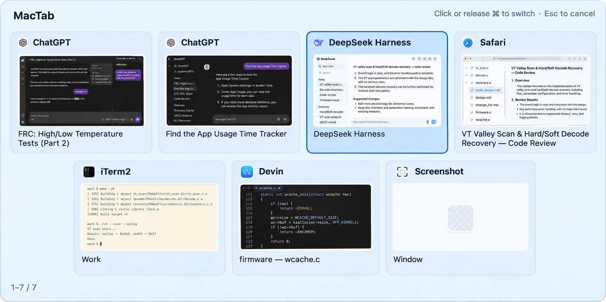

# MacTab

## Go straight to the window you need.

**Windows-style Alt+Tab for your Mac, using Command+Tab.**

Have three browser windows open? macOS Command+Tab gives you one app icon. You still have to find the right window. **MacTab puts each window in its own preview card**, so you can choose the document, project, or connection you actually need.

*Based on a real MacTab screenshot, cropped and AI-edited for an English preview. Text inside thumbnails has been redrawn. [View full-size](docs/images/mactab-preview.png).*

**[Download MacTab 0.2.0 for Mac](https://github.com/bruce1914/MacTab/releases/download/v0.2.0/MacTab-0.2.0-universal-unnotarized.zip)** · [All releases](https://github.com/bruce1914/MacTab/releases) · [Build from source](docs/BUILDING.md)

macOS 14+ · Apple Silicon & Intel · Free and open source · MIT

> **Preview release:** the download is not notarized, so macOS may block it. Building from source is recommended until a notarized release is available. [Build and signing details](docs/BUILDING.md).

## New in 0.2.0

Hover over a card to reveal **×** in its top-right corner. Close a window directly from the switcher, then keep browsing. Closed cards disappear promptly without waiting for a full window scan; the app’s own save prompt still protects unsaved work.

## Less searching. Faster switching.

- **Several windows in one app?** See each one separately, with its title and a thumbnail.
- **Moving between two tasks?** A quick Command+Tab returns to the last window. Press it again to go back.
- **Know it when you see it?** Point at a card and click to switch immediately. Hovering never changes your keyboard selection.
- **Done with a window?** Hover over its card and click the top-right **×** to close it. The app still handles any unsaved-work prompt.
- **Working inside Parallels Windows?** MacTab steps aside so Parallels keeps control of guest shortcuts.

## Start in three steps

1. Move **MacTab.app** to your Applications folder and open it.
2. From the menu-bar settings, allow **Accessibility**. Optionally allow **Screen Recording** to see window previews.
3. Click **Enable**, then hold **Command** and press **Tab**.

MacTab starts paused on first launch. Without Screen Recording, cards show app icons and switching still works. Pause or quit from the menu bar to restore the system switcher. Do not enable another Command+Tab replacement at the same time.

## Keyboard or mouse. Your choice.

| Action | Result |
| --- | --- |
| Quick **Command+Tab** | Return to the previous window |
| Hold **Command**, press **Tab** | Select the next window |
| Hold **Command**, press **Shift+Tab** | Select the previous window |
| Release **Command** | Switch to the selected window |
| **Escape** | Cancel and stay where you were |
| Hover, then click **×** | Close that window; keep browsing the remaining cards |
| Hover, then **left-click** a card | Switch to that window immediately |

## Small by design

Native Swift and AppKit. No ads, subscriptions, analytics, network requests, or automatic login startup. Window previews are created on demand and cleared when the gallery closes. The raw-image cache is capped at **8 MiB**; total process memory is higher. [Privacy and memory details](docs/PRIVACY.md).

## Before you rely on it

The standalone app has been checked on macOS 14.8.9 / Apple Silicon, including thumbnails, card clicks, and Parallels guest shortcuts. **25 automated tests pass.** Intel binaries compile, but have not been tested on Intel hardware.

Minimized or offscreen windows may show icons instead of previews. Some apps do not expose usable windows; switching across Spaces and full-screen apps is not guaranteed. [Compatibility and validation](docs/COMPATIBILITY.md).

Found a window that will not switch? [Report an issue](https://github.com/bruce1914/MacTab/issues) with your macOS version, app name, and steps to reproduce.

[MIT License](LICENSE) · Copyright © 2026 bruce1914
